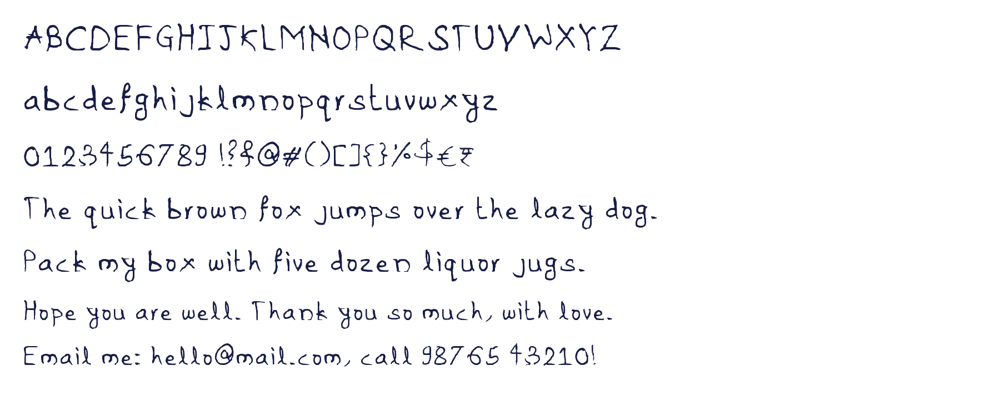
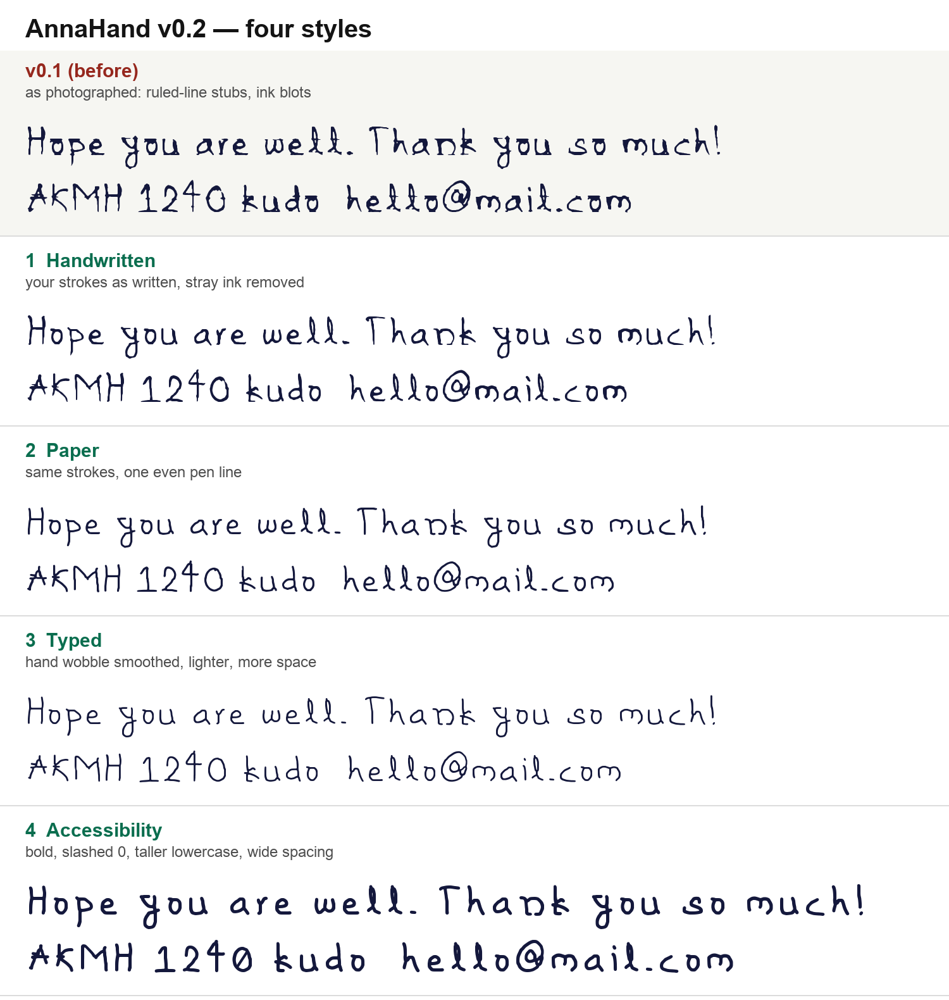
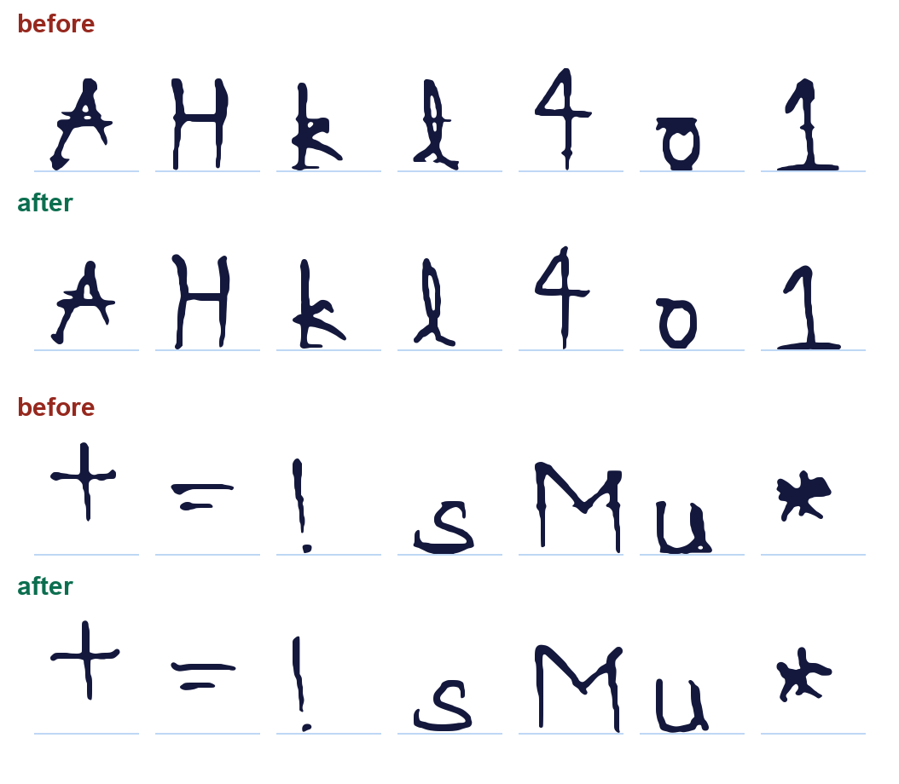

# AnnaHand

A font made from YedaAnna's own handwriting.

## Four styles

All four come from the same handwriting. Only the pen changes.

1. **AnnaHand** — handwritten. Your strokes as written, stray ink removed.
2. **AnnaHandPaper** — one even pen line, like a gel pen.
3. **AnnaHandTyped** — wobble smoothed, lighter line, a bit more space.
   For long text and documents.
4. **AnnaHandAccess** — bold, wide spacing, taller small letters,
   0 with a slash so it never looks like O. For low vision and small screens.

## Get the font

Each style has its own folder in `fonts/`.

- **Mac, iPhone, iPad:** the `.otf`
- **Windows, Android, Office:** the `.ttf`
- **Websites:** the `.woff2` + the `.css`

Install:

- **Mac:** double-click the `.otf`, then click "Install Font".
- **Windows:** right-click the `.ttf`, then "Install for all users".
- **iPhone / iPad:** open the `.otf` in an app that can install fonts.
- **Web:** copy the `.woff2` and `.css`, link the CSS, then use
  `font-family: "AnnaHand";` (or `AnnaHandTyped`, ...).
- **Google Docs:** cannot use your own fonts.

## What is in it — v0.2

- A to Z, a to z, 0 to 9.
- Most punctuation: `. , ; : ! ? ' " - _ ( ) [ ] { } / \ | ~ ^ @ # & * % + = < >`
- Symbols: `$ € £ ¥ ₹ —`
- Missing: the backtick `` ` ``.

## How it was made

1. Five notebook photos, kept in `handwriting/2026-10-10/`.
2. Each letter was cut out of the alphabet pages (blue ink only, ruled lines removed).
3. Where a letter was written 2 or 3 times, the most typical copy was picked.
4. Letters were put on one baseline and sized to the same cap, x-height and ascender.
5. Stray ink was removed (see below).
6. Outlines were traced and saved as OTF, TTF, WOFF2 and WOFF.

## Stray ink fixed in v0.2

- **Ruled-line stubs:** where a letter crossed a notebook line, a bit of
  the line stuck to it (H, 4, k, l, A, 1, +). Removed by finding the
  ruled lines and dropping ink on them that is paler than the pen.
- **Lines inside letters:** a line ran through the top of `o` and across
  `l`. Removed the same way.
- **Ink blots:** pen pressure pooled at stroke ends and joins
  (A, *, u, d). Capped to the normal stroke width.
- Real strokes that lie on a line, like the bottom of `s` or the bar of `4`,
  are pen-dark and stay.

## Add more handwriting

Put new photos in a new dated folder under `handwriting/`.
More copies of each letter make the average shape better.

To rebuild (Python 3.10+):

    pip install -r tools/requirements.txt
    cd tools
    python extract.py          # cut letters out of the photos
    python make.py ../fonts/AnnaHand AnnaHand --style hand
    python make.py ../fonts/AnnaHandPaper AnnaHandPaper --style paper
    python make.py ../fonts/AnnaHandTyped AnnaHandTyped --style typed
    python make.py ../fonts/AnnaHandAccess AnnaHandAccess --style access

`tools/specs.py` says which characters are on which line of which photo.
New photos need a new entry there.
